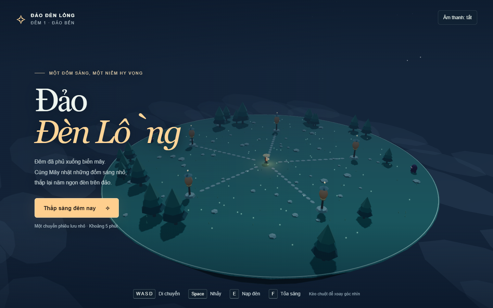

# Đảo Đèn Lồng — Nguyễn Quốc Hưng — 2A202603553

[**Xem video demo Phase 1 (MP4)**](docs/demo/demo.mp4) · [Bằng chứng](docs/proof/phase-1/) · [Spec và giả định](docs/notes/phase-1.md)

Game 3D góc nhìn thứ ba: cùng Mây nhặt đom đóm, thắp năm đèn lồng trên Đảo Bến và tránh Bóng Mực trước bình minh. Học viên K5-L3A. Bài triển khai gốc từ PRD-0 và Test Contract v1.0 do người dùng cung cấp; giữ tài liệu starter ở [docs/assignment](docs/assignment/README.md).

**Phạm vi hiện tại: Phase 1.** Ticket-02/03/04 chưa được cung cấp; các phase sau và Release cuối `v1.0.0` chưa hoàn thành. Thời điểm commit/tag là thời gian thực tế, không xác nhận đúng hạn ca học hoặc đã nộp LMS.



## Cài đặt và chạy

Cần Node.js **22 trở lên**, npm và trình duyệt có WebGL 2 (Chrome, Edge, Firefox hoặc Safari mới). Trong thư mục repo, chạy ba lệnh trên Windows/macOS/Linux:

```bash
npm ci
npm run build
npm start
```

Mở **http://127.0.0.1:4173**. Bản build nằm trong `dist/`, có thể đưa nguyên thư mục lên bất kỳ static host nào; không dùng CDN hoặc cần Internet khi chơi sau khi đã build. Headless không cần trình duyệt hoặc GPU.

## Điều khiển và luật chơi

| Thao tác | Điều khiển |
| --- | --- |
| Di chuyển theo camera | W A S D hoặc phím mũi tên |
| Xoay camera | Kéo chuột hoặc kéo trên màn hình |
| Nhảy | Space |
| Nạp đèn gần nhất | E, mỗi lần nhấn nạp một lần |
| Tỏa sáng | F, tiêu 3 đom đóm, bán kính 5 m, hồi 1,2 s |
| Tạm dừng/tiếp tục | Escape hoặc nút Tạm dừng |
| Chơi lại | Nút Chơi lại; R khi đã thắng/thua |
| Cảm ứng | Cụm nút di chuyển, Nhảy, Nạp đèn, Tỏa sáng |
| Âm thanh | Nút bật/tắt, mặc định tắt |

Mỗi đèn cần **10 đom đóm**, túi chứa **12**. Thắp đủ **5 đèn** để thắng. Đèn đã sáng tạo vùng an toàn **4 m**. Mây có **3 sức sống**; chạm Bóng Mực mất một, rơi `floor(carried*0.25)` đom đóm và được bất tử **2 s**. Hết sức sống hoặc hết **300 s** thì thua. Bờ đảo có rào, không phạt rơi.

Điểm: **10** mỗi đom đóm nhặt được, **100** mỗi đèn thắp, **15** mỗi Bóng Mực bị tỏa sáng làm choáng. Khi thắng cộng `floor(số giây còn lại)*2 + sức sống còn lại*50`. Dựng scenario không tự cộng điểm. Toàn bộ thông số thật nằm trong [game.contract.json](game.contract.json); các quyết định còn mơ hồ ghi ở [ghi chú Phase 1](docs/notes/phase-1.md).

## Test Contract v1.0 và headless

```bash
node src/headless.mjs --seed 12 --night 1 --ticks 18000 --out .cache/run.jsonl
```

Ví dụ tình huống thắng nhỏ:

```bash
node src/headless.mjs --seed 12 --night 1 --scenario tests/scenarios/win.json --inputs tests/inputs/win.json --ticks 500 --snapshot-every 1 --out .cache/win.jsonl
```

Mô phỏng cố định **60 tick/s**. Snapshot tick 0 có trước input; input tick k tạo trạng thái và event tick k+1. Input vắng trường giữ giá trị cũ; nút kích hoạt theo cạnh false → true. Khoảng cách tính trên XZ. Snapshot tại các bội của `--snapshot-every` (mặc định 10); dòng cuối luôn là `end`. Tọa độ xuất làm tròn ba chữ số thập phân. Hết bước hoặc thắng/thua: exit 0. JSON/schema đầu vào sai: exit 2, thông báo ra stderr.

## Kiểm chứng

```bash
npm test
npm run verify
npm run test:browser
```

- **56/56 test** kiểm tra luật chơi, cạnh nút bấm, bán kính biên, tick, CLI và đầu vào sai.
- `verify` sinh lại TAP, JSONL, báo cáo và SHA-256 trong [docs/proof/phase-1](docs/proof/phase-1/). Bốn scenario và một lượt chơi màn mặc định đều được chạy lại, so sánh từng byte.
- Màn mặc định seed 12, replay bot qua input hợp lệ, **không có scenario override**: thắng ở tick **2925** (48,75 s mô phỏng), điểm **1922**, còn 3 sức sống. Input có thể tạo lại bằng `node scripts/playthrough.mjs`.
- Browser QA dùng Chrome/Chromium có sẵn hoặc biến `QA_BROWSER` trỏ tới executable. Kiểm tra thật chuyển động, nhảy, tỏa sáng, nạp/thắng, thua, chơi lại và cảm ứng; lưu ảnh và báo cáo. Một số tình huống UI được dựng bằng scenario qua `?qa=1`, có ghi rõ trong báo cáo.
- CI có cấu hình Ubuntu/macOS trong [.github/workflows/verify.yml](.github/workflows/verify.yml). Kết quả local không được dùng để khẳng định CI đã xanh hoặc hidden tests đã đạt.
- Cài hook chặn commit khi kiểm chứng lỗi: `git config core.hooksPath .githooks`. Hook đã được cài cho checkout phát triển này; người clone cần tự bật lệnh trên.

Video ghi các frame trình duyệt thật: thử bàn phím, replay bot trên màn mặc định và trình bày báo cáo kiểm chứng. Đây là demo Phase 1, không phải bằng chứng cho Phase 2–4 hoặc phép đo FPS. Xem [metadata video](docs/demo/metadata.json).

## Sáng tạo của tôi

**Giai điệu ánh sáng:** âm thanh tổng hợp Web Audio khi nhặt, nạp và tỏa sáng; âm sắc tăng dần như tiếng chuông nhỏ. Đường đá chia năm nhánh trên đảo, sương mây chuyển động và sắc sáng ấm tăng theo số đèn được thắp. Các chi tiết này chỉ nằm trong renderer, không tạo thực thể gameplay hoặc thay đổi output headless. [Ảnh màn chơi](docs/proof/phase-1/desktop-playing.png) và [ảnh đảo sáng](docs/proof/phase-1/desktop-won.png); kiểm chứng tất định ở `verification.json`.

## Tổ chức và bàn giao

- `src/game.mjs`: luật chơi dùng chung; `src/validation.mjs`: kiểm tra input/scenario.
- `src/headless.mjs`: CLI contract; `src/client.mjs`, `web/`: giao diện và renderer.
- `tests/`: test, scenario, input; `scripts/`: build, serve, verify, browser QA và ghi video.
- [AGENTS.md](AGENTS.md), [.githooks/pre-commit](.githooks/pre-commit): harness đã dùng.
- [Nhật ký AI](docs/notes/ai-log.md), [retro](docs/notes/retro.md), [theo dõi yêu cầu](docs/notes/requirements.md).
- [CREDITS](CREDITS.md), [LICENSE](LICENSE): mã mới theo MIT; tài liệu đề bài giữ quyền của tác giả gốc.

Repo cá nhân: https://github.com/hung309911/K5-L3A-DAY12-NguyenQuocHung-2A202603553-AI-SDLC-Dao-Den-Long
